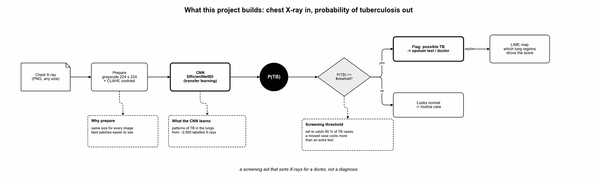
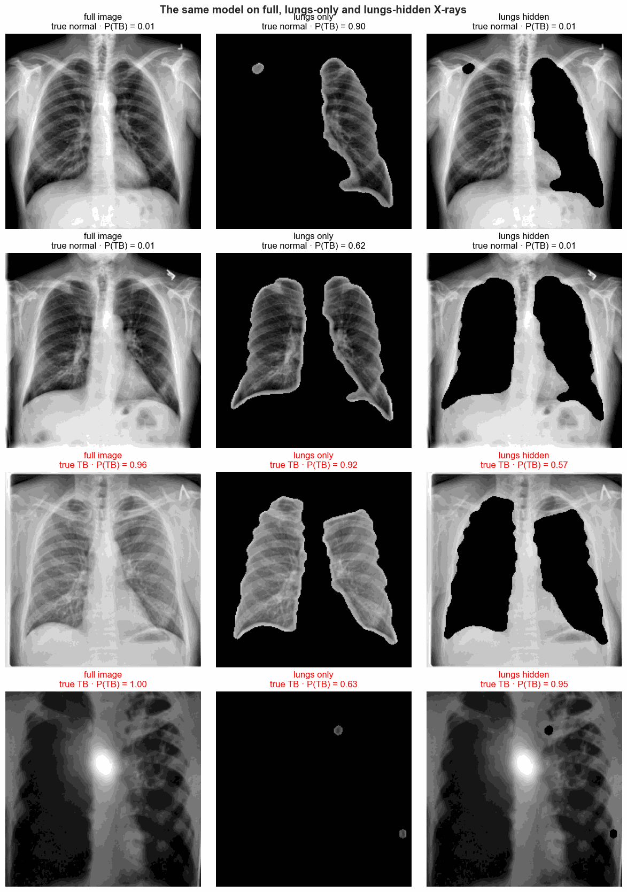
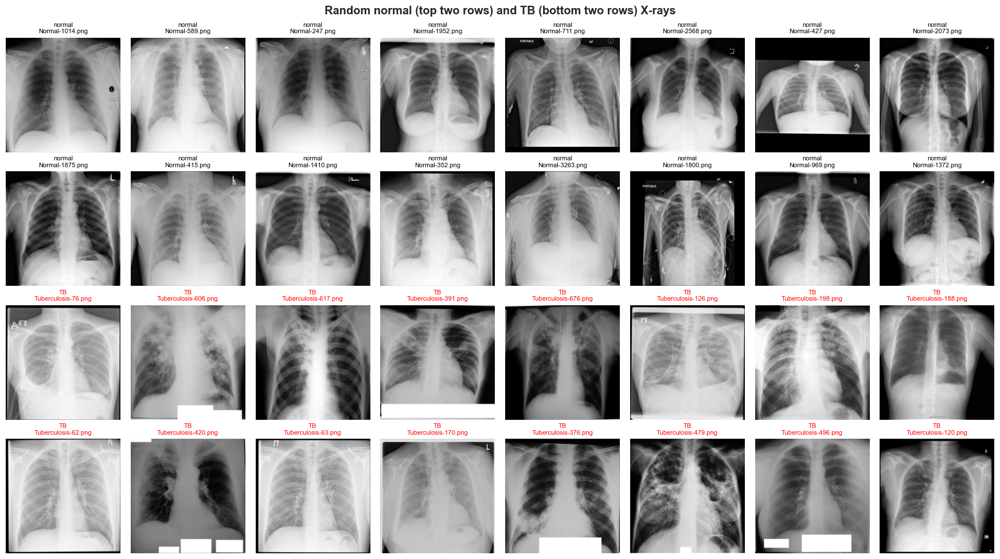
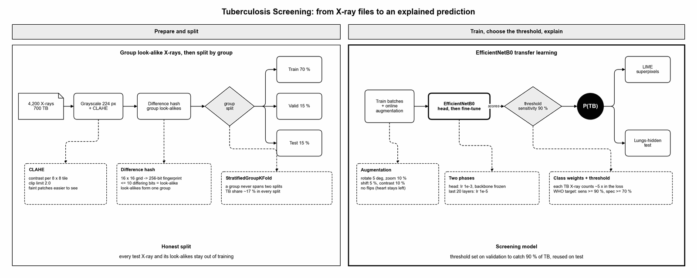
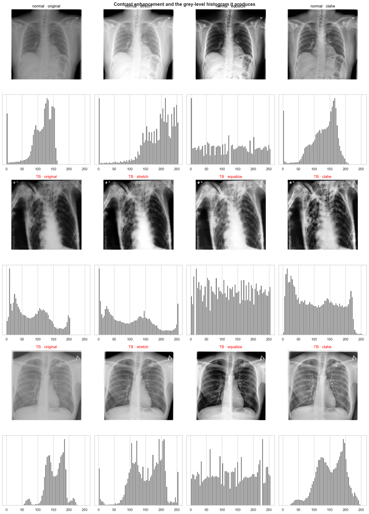
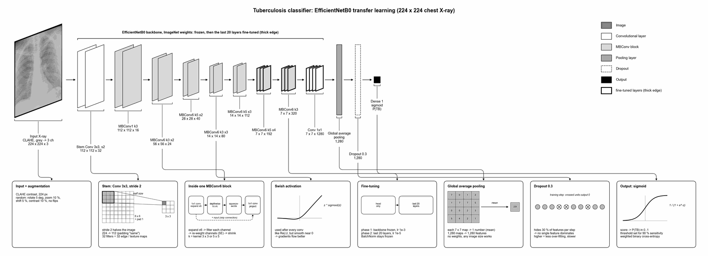
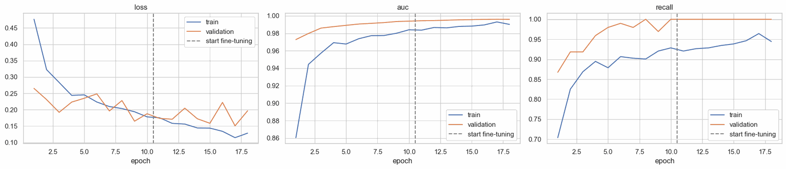
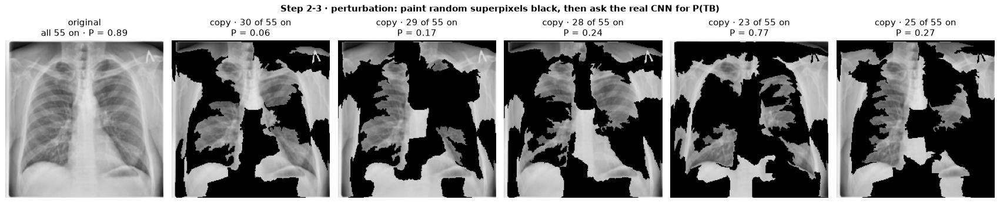
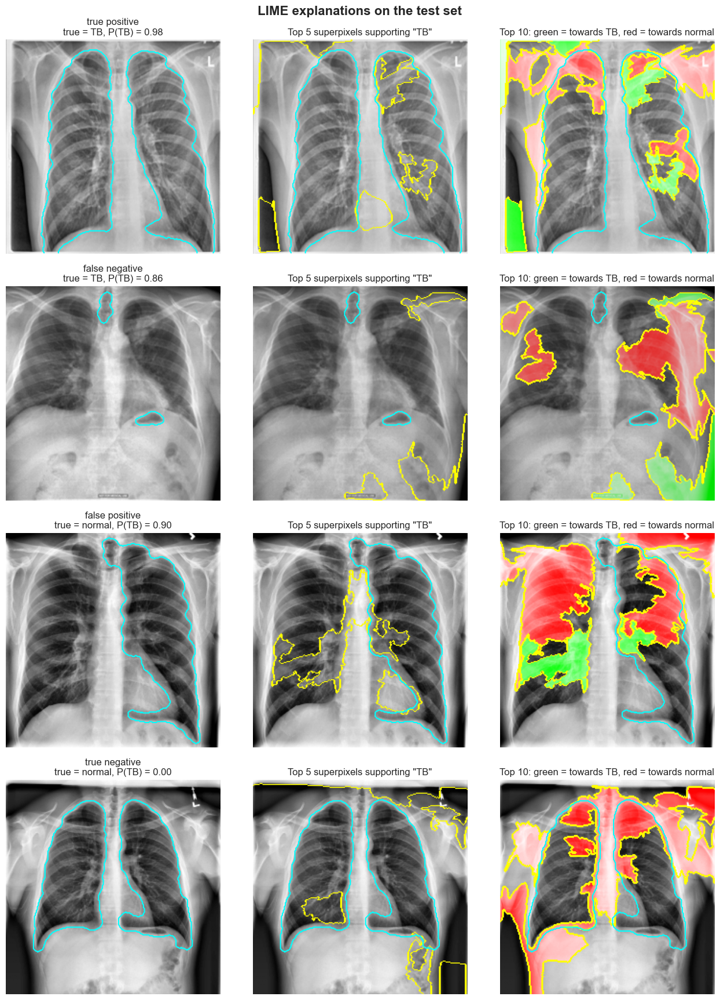

# Tuberculosis Chest X-ray: CNN + LIME

Binary classification | Convolutional Neural Network (CNN) | EfficientNetB0 | Transfer learning | TensorFlow / Keras | Medical X-ray imaging | Contrast enhancement (CLAHE) | Near-duplicate detection | Grouped split | Class imbalance | LIME | Shortcut testing | Gradio

## Objective

- **Problem** → tuberculosis still kills more than a million people a year; many clinics can take a chest X-ray but have no radiologist on duty, so X-rays wait
- **Why this repo** → train a CNN that gives every X-ray a probability of TB, set the threshold so it catches 90 % of TB cases, and test whether it looks at the lungs or at the hospital the X-ray came from
- **Real-world use** → a triage queue: likely-TB X-rays are read first and sent for a sputum test; the LIME map shows the doctor which regions drove the score
- **Business type** → healthcare, screening and triage
- **Learning problem** → binary image classification (normal 0 / TB 1)
- **Expected result** → P(TB) per X-ray + a screening decision + an explanation map

## Highlights

**Question:** is the model good enough to sort X-rays for a doctor?

**Answer:** on this dataset, yes. On 597 unseen X-rays it reaches ROC-AUC 0.997 and clears the WHO triage target (sensitivity ≥ 90 %, specificity ≥ 70 %) with room to spare.

| Test set (597 X-rays, 99 TB) | Value |
|---|---|
| ROC-AUC | **0.997** |
| Sensitivity (TB caught) | **93.9 %** · 93 of 99, 6 missed |
| Specificity (normal cleared) | **99.8 %** · 1 false alarm in 498 |
| Threshold (set on validation for 90 % sensitivity) | 0.881 |

**Question:** is it reading the lungs, or the hospital?

**Answer:** partly the hospital. With the lungs blacked out, the same model still scores ROC-AUC 0.981. The sources explain why: every Belarus X-ray is TB, every Kaggle / RSNA X-ray is normal, and all 308 grayscale files are TB. The score is real on this dataset, but a new hospital's X-rays would likely score lower.

| Same model, test set | ROC-AUC | TB still flagged |
|---|---|---|
| Full image | 0.997 | 93.9 % |
| Lungs hidden | 0.981 | 49.5 % |
| Lungs only | 0.691 | 69.7 % |

**Question:** what does the average TB X-ray look like compared with a normal one?

**Answer:** brighter inside the lungs (denser tissue, the disease signal), but the largest differences sit at the top corners and borders (up to +60 grey levels): acquisition differences between sources.

## [1/8] Data

- **Dataset** → [Tuberculosis (TB) Chest X-ray Database](https://www.kaggle.com/datasets/tawsifurrahman/tuberculosis-tb-chest-xray-dataset) · 3,500 normal + 700 TB · 512 × 512 PNG (not stored in this repository)
- **Imbalance** → 1 TB for every 5 normal → "always normal" is 83 % accurate and useless → ROC-AUC, sensitivity, specificity
- **Sources** → NLM Montgomery + Shenzhen (800, 49 % TB) · Belarus (306, all TB) · Kaggle / RSNA (3,094, all normal)
- **Files** → grayscale files are all TB; TB files are smaller and more varied (median 142 kB vs 169 kB)

## [2/8] Run on Kaggle

- **Import** → Create → Import Notebook → upload `tuberculosis_classification_cnn_lime.ipynb`
- **Input** → dataset `tawsifurrahman/tuberculosis-tb-chest-xray-dataset` (found anywhere under `/kaggle/input`)
- **Accelerator** → GPU (T4); Internet on (ImageNet weights, `pip install lime`)
- **Settings** → top cell; `SAVE_MODEL = False`, `LAUNCH_APP = False` → nothing is written, no app is started
- **App on Kaggle** → `LAUNCH_APP = True` prints a temporary public Gradio link

## [3/8] Near-duplicates and split

- **Difference hash** → 16 × 16 grid → 256-bit fingerprint; ≤ 10 differing bits = look-alike → 20 X-rays in 9 groups, none mixing classes
- **Split** → `StratifiedGroupKFold` by group → train 3,004 · validation 599 · test 597, each ~16.6 % TB

## [4/8] Image preparation

- **Grayscale 224 × 224** → one channel, copied to 3 per batch for the ImageNet backbone
- **CLAHE** → contrast per 8 × 8 tile, clip 2.0 → faint patches easier to see

- **Lung mask** → Otsu threshold + morphology → rough, used only for the shortcut test

## [5/8] Model

- **EfficientNetB0** (ImageNet) + global average pooling + dropout 0.3 + sigmoid
- **Class weights** → normal 0.60, TB 2.99 (each TB X-ray counts ~5 ×)
- **Online augmentation** → rotation ±5°, zoom ±10 %, shift ±5 %, contrast ±10 %, no flips (the heart stays on the left)
- **Training** → head (lr 1e-3, best val AUC 0.9938) → last 20 layers (lr 1e-5, best val AUC 0.9960)

## [6/8] Explanations (LIME)

- **LIME in one line** → hide parts of the X-ray and watch how P(TB) changes; the parts that change it most are the parts the CNN looks at
- **How** → cut the X-ray into ~60 pieces (superpixels) → 300 copies with about half the pieces painted black → P(TB) for every copy → a straight-line model gives each piece a weight

- one test X-ray per confusion-matrix cell; green → towards TB, red → towards normal, cyan → lung mask
- true positive → green in the left lung, but also on a black border strip; misses → strongest regions on the abdomen and edges

## [7/8] App

- **Run locally** → `pip install -r requirements.txt` → `python app.py`
- **Model** → `models/tuberculosis_effnetb0.keras` + `models/settings.json` (threshold 0.881)
- **Examples** → set `TB_DATA_DIR` to the dataset folder; no X-rays are stored here
- **Output** → P(TB), a screening decision, a LIME map with the lung outline

## [8/8] Next steps

- **Source-held-out test** → train on some collections, test on another: the honest "new hospital" score
- **Lungs-only training** → U-Net lung segmentation (Montgomery / Shenzhen masks), classify the lungs only
- **Grad-CAM** → cross-check LIME with the CNN's own feature maps
- **More TB sources** → NIAID TB portal (data agreement required)
- **Calibration** → does P(TB) = 0.8 mean 8 in 10?

| Path | Content |
|---|---|
| `tuberculosis_classification_cnn_lime.ipynb` | full notebook (Kaggle-ready) |
| `app.py`, `requirements.txt` | Gradio screening app |
| `models/` | trained model and threshold |
| `assets/` | figures and editable draw.io diagrams |
| `arch/` | first version of this project |
